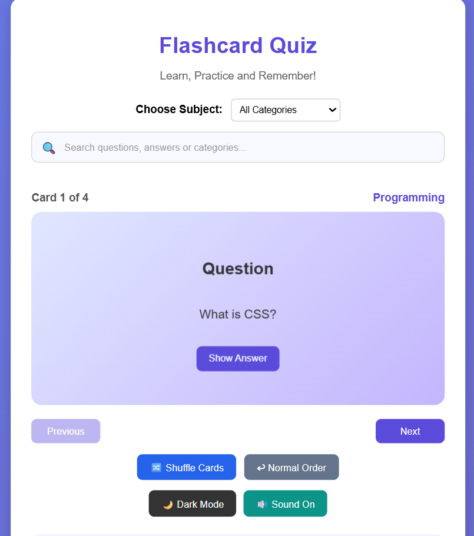
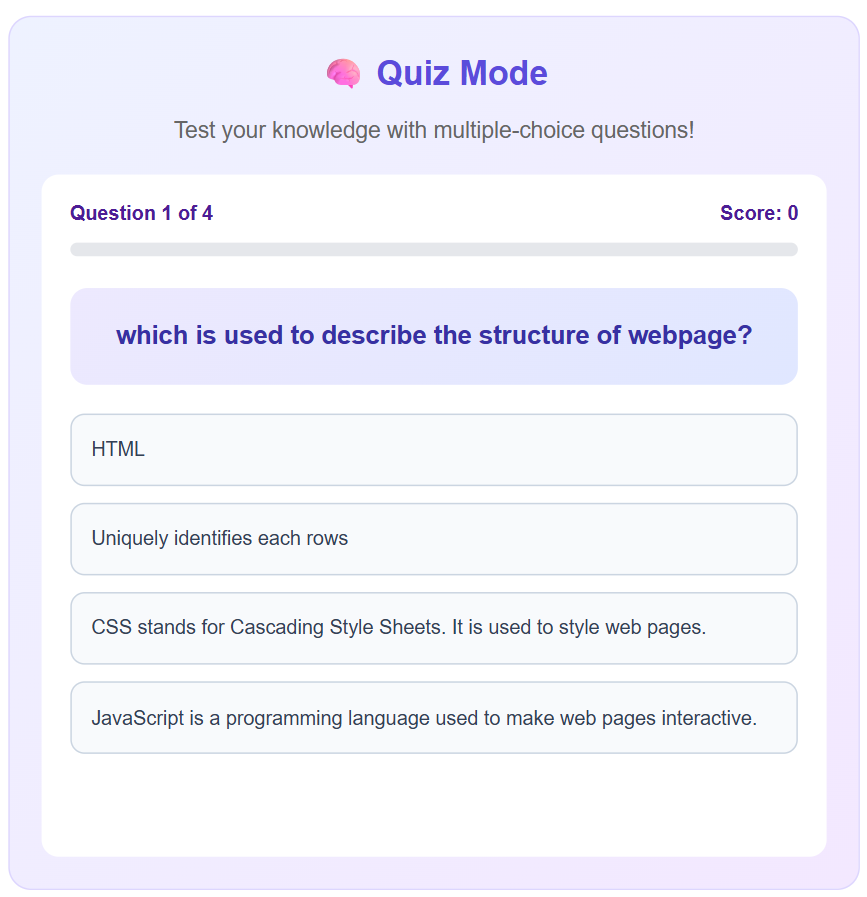
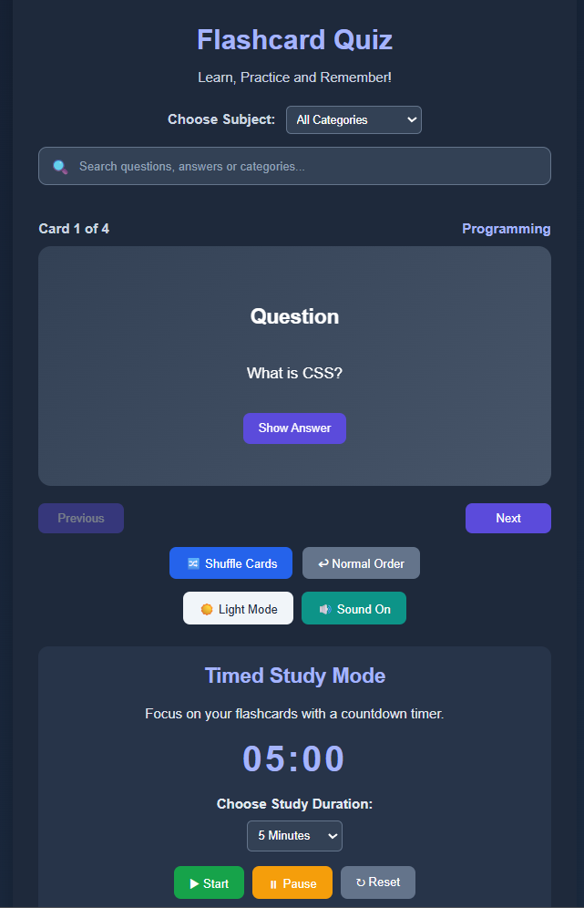
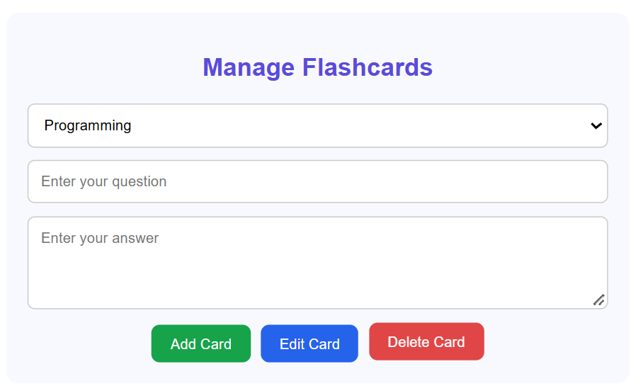
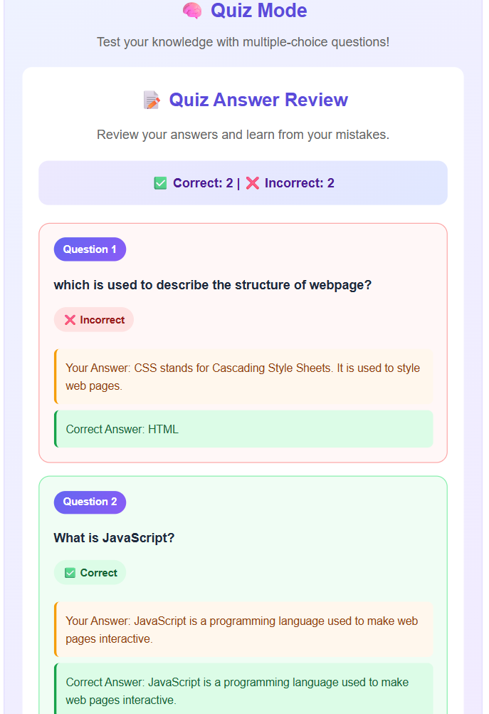

# Flashcard Quiz App

An interactive Flashcard Quiz App built using HTML, CSS, and JavaScript to help users study, practice, and track their learning progress.

## About the Project

This application provides an interactive learning experience through flashcards and quizzes. Users can create and manage flashcards, test their knowledge, track their progress, and review their quiz answers.

## Features

- Create, edit, and delete flashcards
- Flip flashcards to reveal answers
- Previous and next card navigation
- Know It and Need Practice tracking
- Learning progress dashboard
- Category-based flashcards
- Shuffle flashcards
- Live search
- Dark mode
- Study timer
- Sound toggle
- Badges and achievements
- Daily streak tracking
- Quiz mode with multiple-choice questions
- Score tracking and progress bar
- Immediate answer feedback
- Quiz results with performance summary
- Review quiz answers
- Retry incorrect questions
- Local Storage to save data
- Responsive user interface

## Technologies Used

- HTML5
- CSS3
- JavaScript
- Local Storage

## Screenshots

### Home Screen



### Learning Progress Dashboard


### Quiz Mode



### Dark Mode



### Flashcard Management



### Quiz Review



## How to Run

1. Clone or download this repository.
2. Open the project folder in Visual Studio Code.
3. Open `index.html`.
4. Run the application using Live Server or open the HTML file in a browser.

## Project Structure

```text
CodeAlpha_FlashcardQuizApp/
│
├── index.html
├── style.css
├── script.js
├── quiz.js
├── Flashcard_App/
│   ├── home.png.png
│   ├── learning progress.png.png
│   ├── quizmode.png.png
│   ├── darkmode.png.png
│   ├── managecards.png.png
│   ├── reviews.png.png
│   └── daily streaks.png.png
│
└── README.md